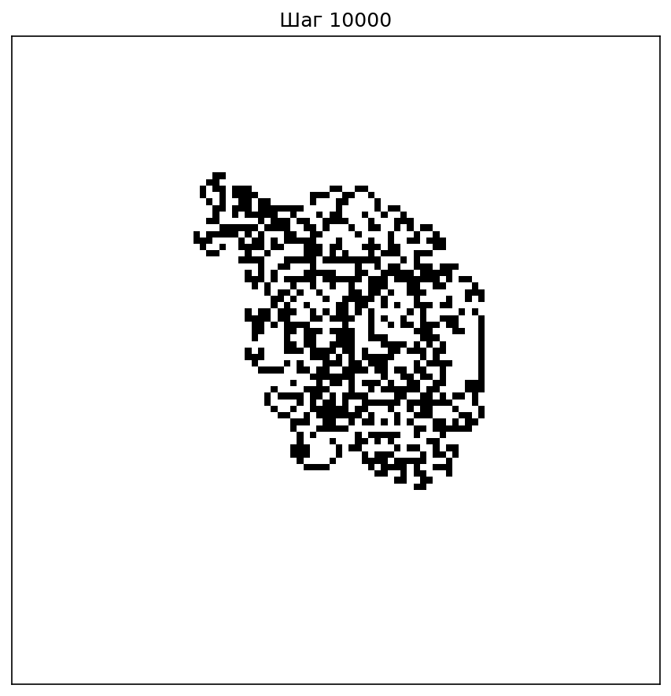
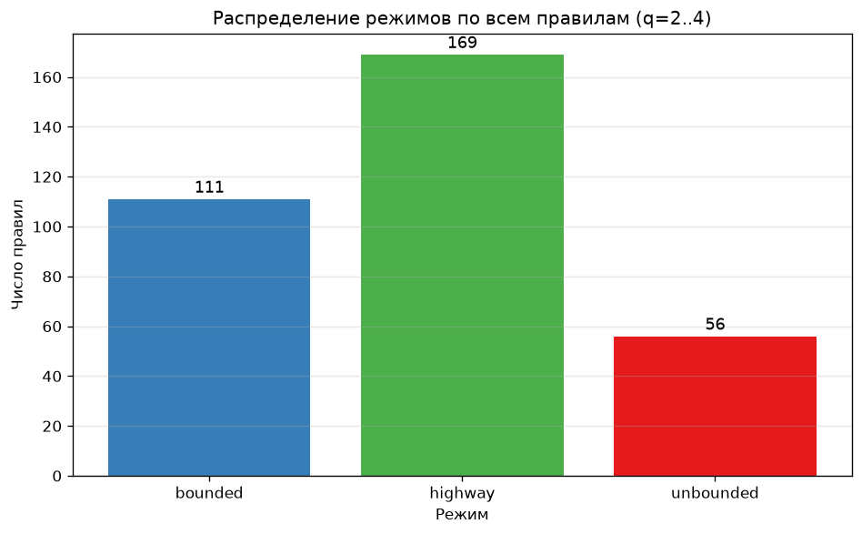
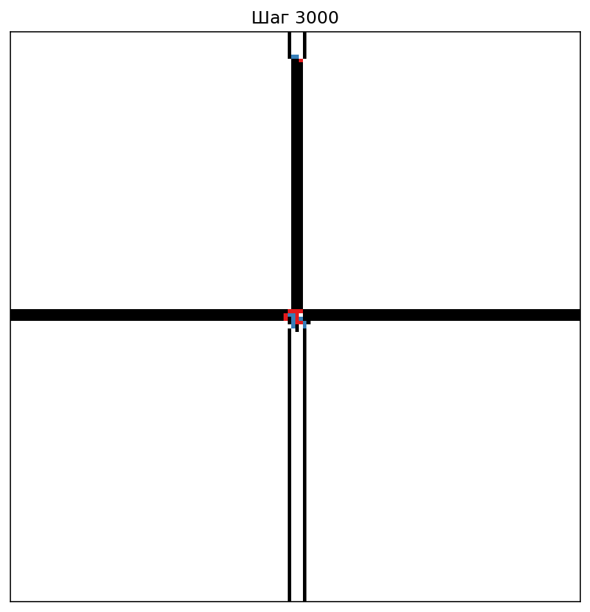
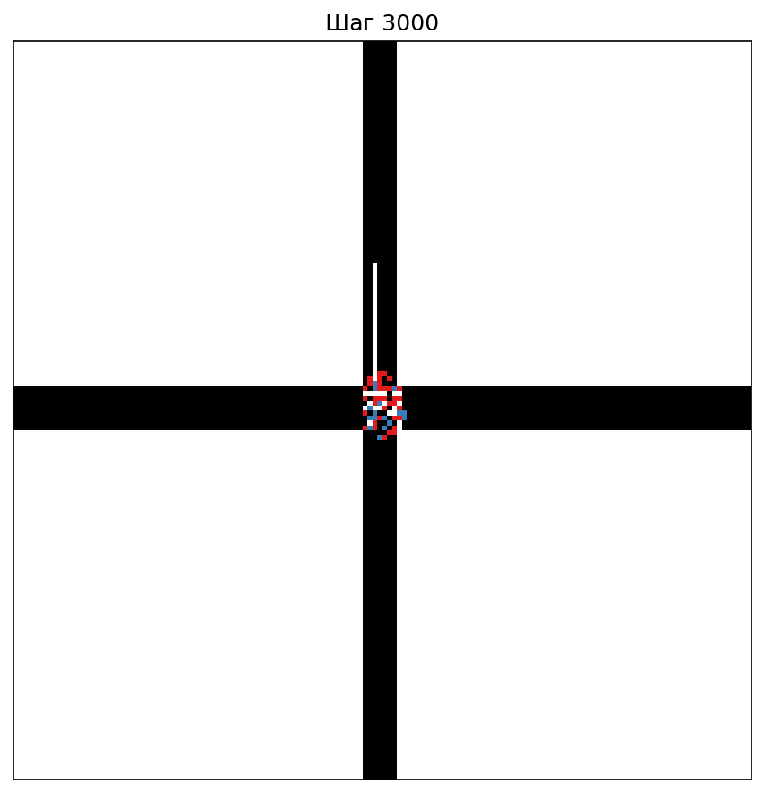
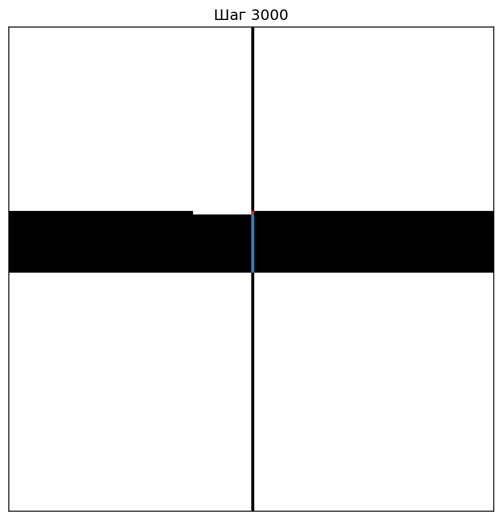
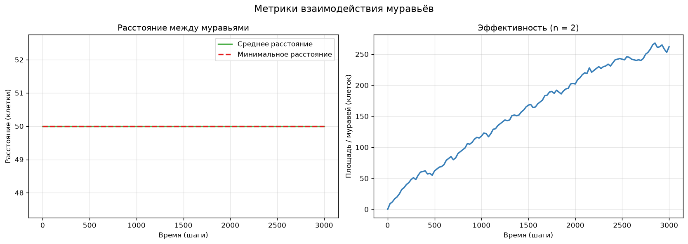
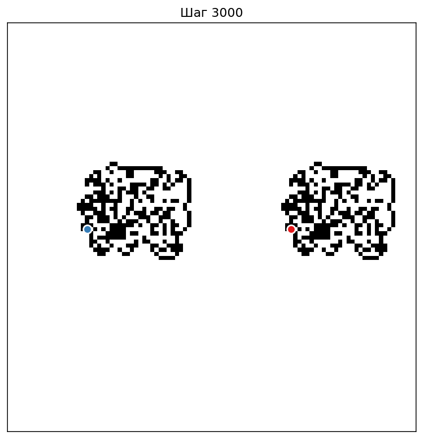
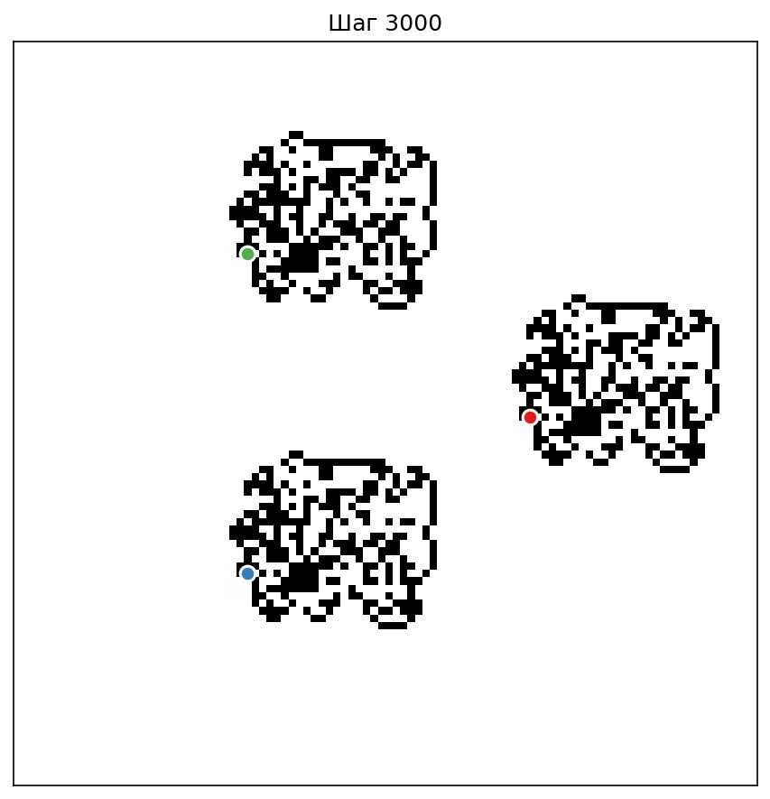

# 🐜 Муравей Лэнгтона: клеточный автомат с 3 уровнями сложности

> Домашнее задание по курсу «Компьютерное моделирование»

## 🎯 О проекте

Клеточный автомат «Муравей Лэнгтона» с 3 уровнями сложности и полным исследованием режимов поведения.

| Уровень | Что исследуется | Главный результат |
|---------|-----------------|-------------------|
| **L1** | Классический муравей | Хайвей после ~10 000 шагов, период 104 |
| **L2** | Многоцветные правила (q=2..4) | 336 правил перебрано, 50% дают хайвей |
| **L3** | Несколько муравьёв | Sequential vs Synchronous, коллективное поведение |

## 🎮 Уровень 1 — Классический муравей

Два цвета, один муравей, правило R/L. За ~10 000 шагов строит диагональный хайвей.

  

Результат: results/l1/ant_animation.gif (анимация), графики black_ratio.png, visited_area.png.

## 🎮 Уровень 2 — Многоцветный муравей

q цветов, строка правил из R/L/F/U. Перебираем все правила для q=2, 3, 4.

  

Ключевой вывод:
С ростом q доля bounded падает (75% → 25%), доля highway растёт (25% → 55.5%). unbounded появляется только при q ≥ 3.

| q | bounded | highway | unbounded |
|---|---------|---------|-----------|
| 2 | 75% | 25% | 0% |
| 3 | 54.7% | 35.9% | 9.4% |
| 4 | 25% | 55.5% | 19.5% |

Примеры лучших правил:

  
  
  

## 🎮 Уровень 3 — Несколько муравьёв

n муравьёв на общем поле. Два режима обновления: sequential и synchronous.

  

Ключевой вывод:
При отсутствии прямых столкновений sequential и synchronous дают визуально идентичные структуры — значит, порядок обновления влияет только при реальном взаимодействии агентов.

Финальные кадры (2 и 3 муравья):

  
  

## 🚀 Установка

git clone https://github.com/Valdemarchik93/DZ-KM-langton-ant-ca.git
cd DZ-KM-langton-ant-ca
python -m venv .venv
.venv\Scripts\Activate.ps1
pip install -r requirements.txt

## ⚡ Быстрый старт

## Все тесты
python -m pytest tests/ -v

## L1 — хайвей
python -m src.main run-l1 --steps 15000 --boundary expand --output results/l1_expand

## L2 — полный sweep
python -m src.main sweep-l2 --max-q 4 --steps 2000
python -m src.analyze

## L3 — сравнение sequential vs synchronous
python -m src.main run-l3 --ants 2 --update sequential --output results/l3_seq
python -m src.main run-l3 --ants 2 --update synchronous --output results/l3_sync

## 🏗 Архитектура

langton-ant-ca/
├── src/
│   ├── ant.py                  # L1: классический муравей
│   ├── multi_color_ant.py      # L2: многоцветный
│   ├── multi_ant.py            # L3: мир муравьёв
│   ├── metrics.py              # метрики + классификация
│   ├── simulate.py             # запуск сценариев
│   ├── visualize.py            # графики + GIF
│   ├── analyze.py              # анализ sweep
│   ├── cli.py                  # CLI на click
│   └── main.py                 # точка входа
├── tests/
│   ├── test_ant.py             # 14 тестов L1
│   ├── test_multi_color.py     # 13 тестов L2
│   └── test_multi_ant.py       # 12 тестов L3
├── results/                    # результаты экспериментов
├── requirements.txt
└── README.md

## 🧪 Тестирование

Все 39 тестов проходят за ~0.3 секунды.

| Модуль | Тестов | Что проверяется |
|--------|--------|-----------------|
| test_ant.py | 14 | Повороты, границы, метрики, детектор хайвея |
| test_multi_color.py | 13 | Циклы цвета, команды R/L/F/U, границы |
| test_multi_ant.py | 12 | Порядок обновления, столкновения, симметрия |

## 📄 Лицензия

MIT License — свободно для образовательных и исследовательских целей.